<div align="center">

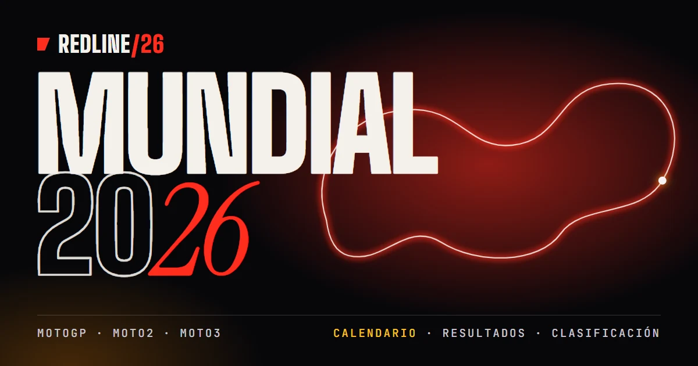

<br>

**El Mundial de MotoGP 2026 contado como una retransmisión, con datos oficiales que se actualizan solos tras cada sesión.**

<br>

[](https://redline-26.pages.dev/)


</div>

---

## En 30 segundos

<div align="center">
<a href="https://redline-26.pages.dev/">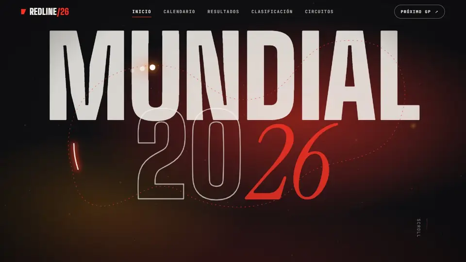</a>
<br><sub>▶ La portada: el trazado se dibuja solo y cada categoría tiene su escena al hacer scroll.</sub>
</div>

<br>

REDLINE/26 sigue el **Mundial de MotoGP, Moto2 y Moto3** en cinco páginas: inicio, calendario, resultados, clasificación y circuitos.

- 📡 **Se mantiene sola**: un proceso automático lee la API pública de resultados cada 30 minutos en fin de semana de carrera y la web se actualiza sola, sin tocar el código ni volver a publicar.
- 🧮 **Calcula, no copia**: ganadores, poles, constructores, puntos en juego y quién ya es campeón salen de los datos en bruto.
- ✍️ **Textos que se escriben solos**: los titulares de la portada cambian según quién lidera y por cuánto.
- 🛟 **Nunca en blanco**: si la API falla, usa la última copia guardada.
- 🎬 **Estética de televisión**: tipografía grande, escenas fijas al hacer scroll, cortinillas entre páginas y partículas en 3D.

---

## La web

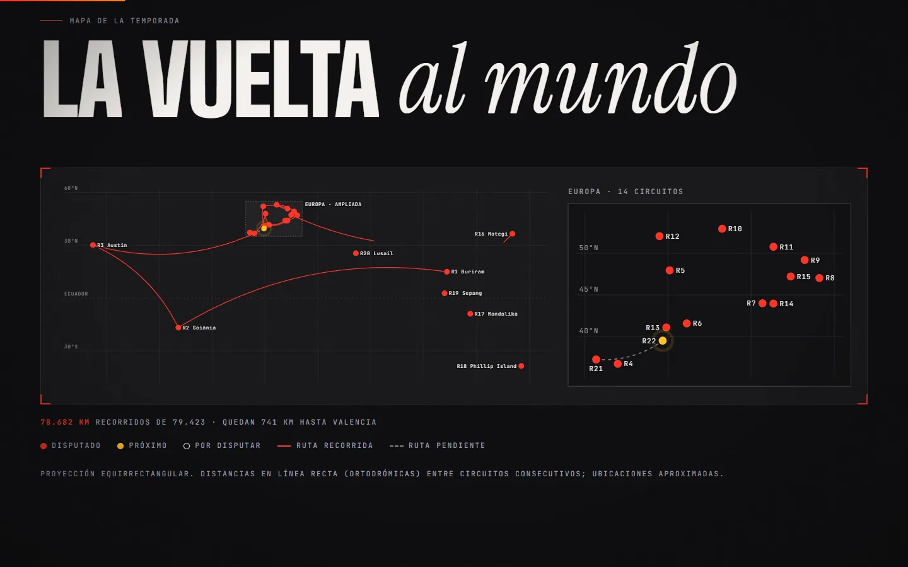
<p align="center"><sub><b>Circuitos</b> · la ruta del Mundial en un mapa SVG hecho a mano, con ampliación de Europa y los kilómetros recorridos.</sub></p>

<table>
<tr>
<td width="50%">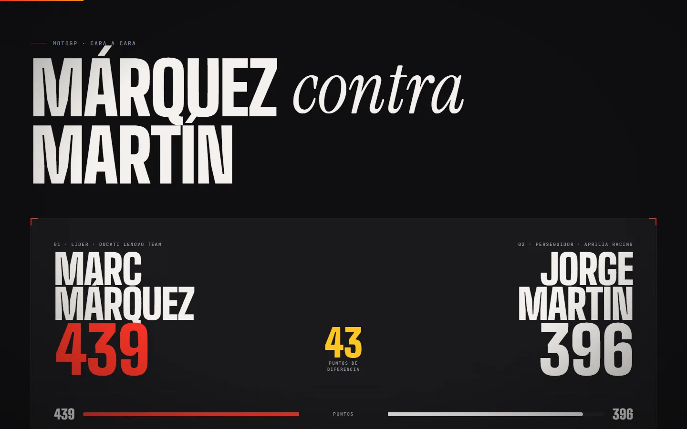<br><sub><b>Clasificación</b> · el duelo por el título, con la ventaja y los puntos que quedan en juego.</sub></td>
<td width="50%">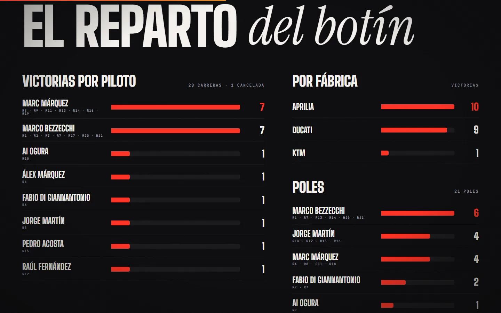<br><sub><b>Resultados</b> · victorias y poles por piloto y por fábrica, calculadas carrera a carrera.</sub></td>
</tr>
<tr>
<td>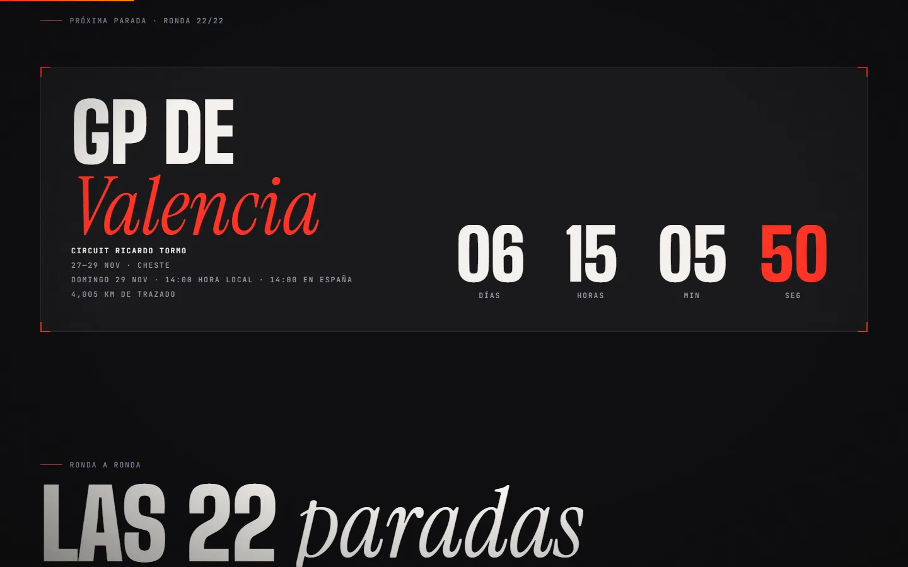<br><sub><b>Próxima carrera</b> · cuenta atrás con la hora local del circuito y la de España.</sub></td>
<td>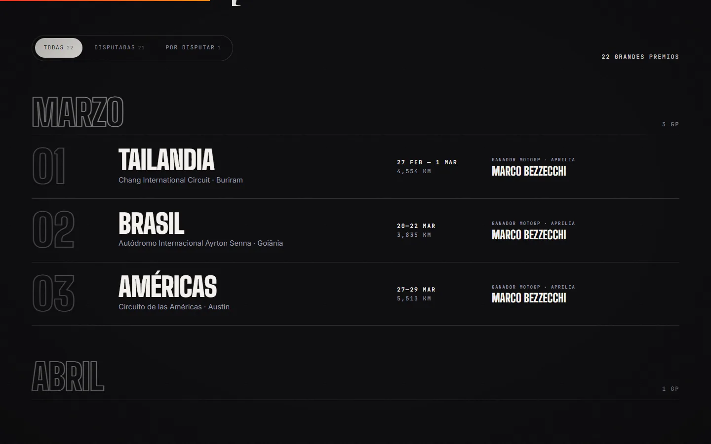<br><sub><b>Calendario</b> · las 22 rondas por meses, con el ganador de cada Gran Premio.</sub></td>
</tr>
</table>

<table>
<tr>
<td width="33%" align="center">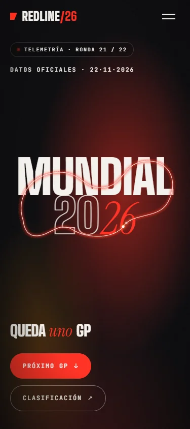</td>
<td width="33%" align="center">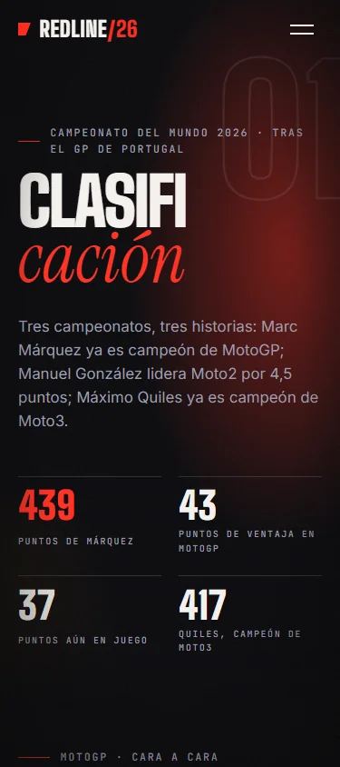</td>
<td width="33%" align="center">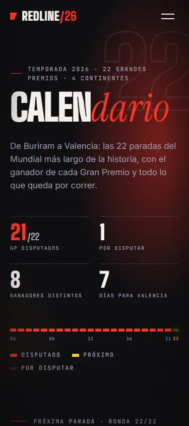</td>
</tr>
</table>
<p align="center"><sub><b>En el móvil</b> · las cinco páginas adaptadas, con menú propio.</sub></p>

---

## Cómo funciona por dentro

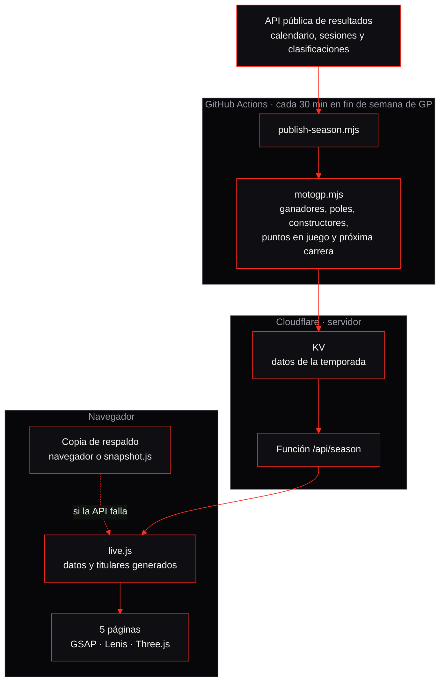

### Decisiones técnicas

| Principio | Cómo se cumple |
|---|---|
| **Cero mantenimiento** | Los resultados no viven en el código: un proceso programado en GitHub Actions los pide a la API, los calcula y los guarda en Cloudflare KV. Publicar solo hace falta si cambia el diseño. |
| **Respetuosa con la fuente** | La API se consulta en un horario fijo (cada 30 minutos en fin de semana de carrera, cada 6 horas el resto), haya las visitas que haya. Los visitantes leen la copia guardada en Cloudflare, que responde al instante. |
| **Tres niveles de respaldo** | API en vivo → última copia guardada en el navegador → copia incluida en la web. |
| **Casos raros contemplados** | Banderas rojas con nueva salida, carreras canceladas y el final de temporada. |
| **Sin compilar** | HTML, CSS y JavaScript con módulos ES. Las librerías van en local, sin depender de CDN. |
| **Rápida y segura** | Cabeceras de seguridad, librerías en caché un año y el resto revalidado en cada visita. |
| **Accesible** | Contraste AA en los textos secundarios y animaciones reducidas para quien tenga activado «reducir movimiento» en su sistema. |
| **Sin material oficial** | Ni logos ni fotos: el trazado de la portada es una ilustración. |

## En cifras

| Concepto | Valor |
|---|---|
| Páginas | **5**, en ordenador y en móvil |
| Categorías | **3**: MotoGP, Moto2 y Moto3 |
| Grandes Premios | **22**, actualizados solos durante la temporada |
| Código | **unas 4.000 líneas** de JavaScript, CSS y HTML, sin contar datos ni librerías |
| Actualización | como mucho 30 minutos después de cada sesión, sin publicar de nuevo |

## Tecnologías

**HTML** · **CSS** · **JavaScript** (módulos ES) · **Cloudflare Pages Functions + KV** · **GitHub Actions** · API REST · GSAP + ScrollTrigger · Lenis · Three.js (WebGL) · SVG

## Estructura

```
index.html · calendario.html · resultados.html · clasificacion.html · circuitos.html
css/main.css               variables, tipografía, componentes y páginas
js/live.js                 carga /api/season (o la copia) y genera los titulares
js/home.js, calendario.js, resultados.js, clasificacion.js, circuitos.js
js/effects.js · fx3d.js    scroll suave, textos animados y partículas WebGL
js/transition.js           cortinilla entre páginas
functions/api/season.js    función /api/season (lee los datos de Cloudflare KV)
lib/motogp.mjs             lectura de la API y cálculos
scripts/publish-season.mjs publica los datos en KV (GitHub Actions, programado)
scripts/build.mjs          prepara dist/ para publicar
scripts/snapshot.mjs       regenera la copia de respaldo
```

**Verla en local:** los módulos ES necesitan un servidor, no basta con abrir el archivo.

```bash
python -m http.server 8080    # y abre http://localhost:8080
```

En local, sin la función de Cloudflare, la web usa la copia de respaldo.

## Autor

Diseñada y desarrollada por **Cristian Corroto**, con apoyo intensivo de IA en el código, las animaciones y la integración con la API. La idea fue mía: que la web se sintiera como una retransmisión de televisión. Elegí el estilo y las animaciones, revisé cada pantalla hasta que la portada estuvo a la altura y, cuando actualizar los datos a mano tras cada Gran Premio se volvió un problema, propuse que la web se actualizara sola y comprobé que los datos coincidieran con los oficiales.

[Ver la web](https://redline-26.pages.dev/) · [Portfolio](https://cristian-corroto.pages.dev) · [LinkedIn](https://www.linkedin.com/in/cristian-corroto)

---

<sub>© 2026 Cristian Corroto. Todos los derechos reservados. MotoGP™, Moto2™ y Moto3™ son marcas de Dorna Sports. REDLINE/26 es un proyecto personal sin relación con Dorna ni con MotoGP; los datos proceden de la API pública de resultados que usa motogp.com.</sub>
